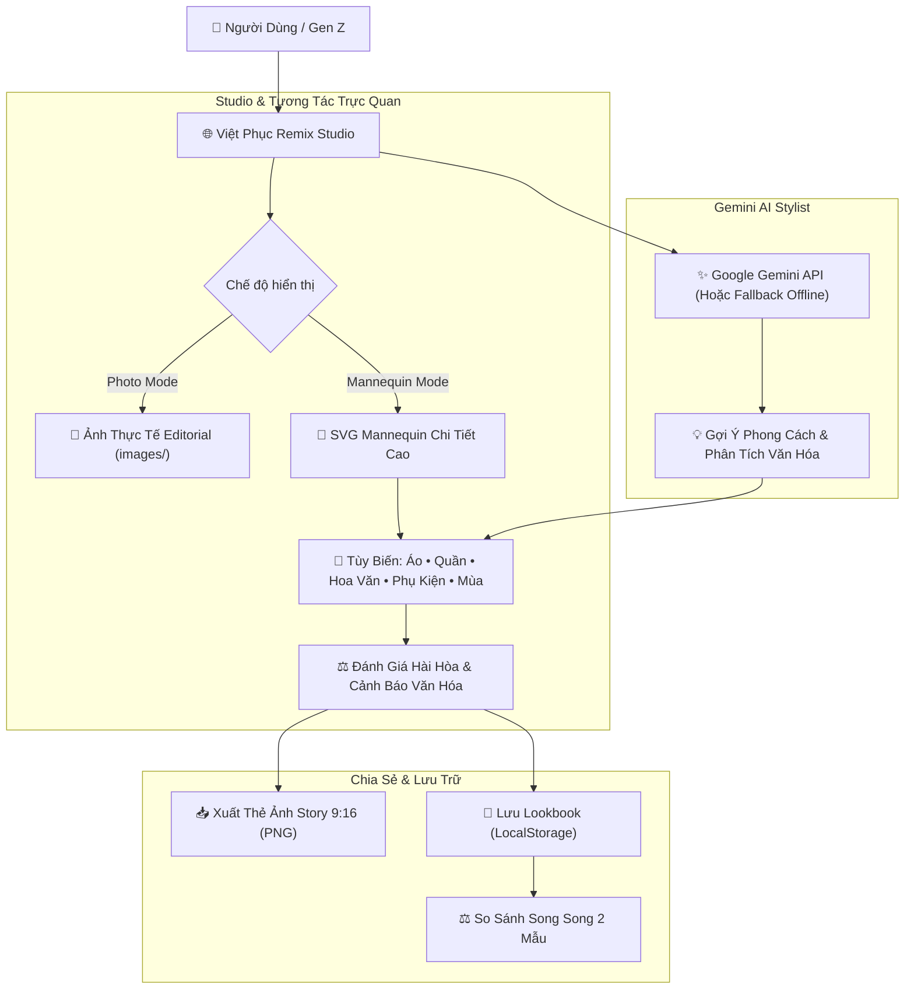

# 🇻🇳 VIỆT PHỤC REMIX — Phối Cổ Phục Cho Gen Z Cùng Gemini AI

> **"Đưa di sản vào hơi thở thời đại"** — Nền tảng Studio tương tác thông minh kết hợp giữa **Mỹ thuật Cổ truyền Việt Nam** và trí tuệ nhân tạo **Google Gemini AI**, giúp thế hệ Gen Z tự tin sáng tạo, phối đồ và lan tỏa tình yêu cổ phục trên mạng xã hội.

[](https://developer.mozilla.org/en-US/docs/Web/HTML)
[](https://developer.mozilla.org/en-US/docs/Web/CSS)
[](https://developer.mozilla.org/en-US/docs/Web/JavaScript)
[](https://ai.google.dev/)
[](LICENSE)

---

## 📖 Mục Lục
1. [Giới Thiệu](#-giới-thiệu)
2. [Điểm Nổi Bật](#-điểm-nổi-bật)
3. [Kiến Trúc & Trải Nghiệm Sản Phẩm](#-kiến-trúc--trải-nghiệm-sản-phẩm)
4. [Cấu Trúc Thư Mục](#-cấu-trúc-thư-mục)
5. [Cài Đặt & Khởi Chạy](#-cài-đặt--khởi-chạy)
6. [Gemini AI Stylist & Prompting](#-gemini-ai-stylist--prompting)
7. [Bảo Vệ Chuẩn Mực Văn Hóa](#-bảo-vệ-chuẩn-mực-văn-hóa)
8. [Tác Động Xã Hội](#-tác-động-xã-hội)

---

## 🌟 Giới Thiệu

Giới trẻ Việt Nam hiện nay có niềm tự hào dân tộc và tình yêu sâu sắc với di sản cổ phục. Tuy nhiên, họ gặp phải **4 rào cản lớn**:
1. **Nỗi sợ thẩm mỹ ("Sợ quê, sợ già")**: Chưa biết cách mix & match cổ phục với phong cách hiện đại (sneakers, kính râm, túi tote, boots).
2. **Nguy cơ vi phạm điển chế văn hóa**: Lo sợ phối sai màu sắc nghi lễ hoặc ngữ cảnh lịch sử thiêng liêng.
3. **Thiếu Studio phối đồ trực quan**: Chưa có công cụ cho phép thử màu, hoa văn dệt, dáng quần/váy và phụ kiện trực tiếp trên mô hình thời trang.
4. **Nhu cầu lan tỏa mạng xã hội (Social Storytelling)**: Thiếu công cụ xuất thẻ ảnh đẹp chuẩn 9:16 để đăng Instagram Story, TikTok, Facebook.

**Việt Phục Remix** ra đời để giải quyết toàn diện 4 bài toán trên bằng cách kết hợp **Studio đồ họa tương tác đa năng** cùng **Trợ lý thời trang thông minh Google Gemini AI**.

---

## ✨ Điểm Nổi Bật

### 1. 🪞 Studio Chuyển Đổi Kép (Dual-View Studio)
- **Chế độ Ảnh Thực Tế (Photo Mode)**: Thưởng thức bộ ảnh editorial thời trang thực tế chất lượng cao của 5 dòng cổ phục: *Áo dài, Áo tứ thân, Áo ngũ thân, Áo bà ba, Áo yếm*.
- **Chế độ Mannequin Đồ Họa Vector (Mannequin Mode)**: Mô hình vector chi tiết cao với giải phẫu thanh tú, búi tóc trâm cài, phản hồi tức thì theo từng thao tác phối đồ:
  - **12 sắc màu truyền thống**: Đỏ son, Vàng hoàng kim, Xanh ngọc, Tím huế, Trắng ngà, Đen tuyền, Xanh lam cổ, Hồng phấn...
  - **5 hoa văn dệt lụa**: Trơn, Gấm hoa cúc chìm, Sọc dệt tơ tằm, Thêu sen nhã nhặn, Hoa văn cổ trang nhã.
  - **5 kiểu quần/váy đa dạng**: Quần lụa trắng truyền thống, Quần lụa đen huyền, Quần đũi suông, Váy đụp truyền thống Bắc Bộ, Quần jeans rách Gen Z cá tính.
  - **9 phụ kiện thời thượng**: Nón lá, Khăn đóng, Guốc mộc, Túi thêu, Vòng kiềng bạc, Hoa tai ngọc, Kính mát Gen Z, Sneakers, Túi tote.
  - **Thời tiết & Phối cảnh mùa**: Áo khoác choàng Thu/Đông & hiệu ứng cánh hoa rơi, lá vàng bay.

### 2. 🤖 Gemini AI Stylist (Cố Vấn Phong Cách Thông Minh)
- **1-Click Prompts**: Tết Gen Z năng động, Kỷ yếu Hoàng Thành uy nghiêm, Dạo phố Nam Bộ trẻ trung, Triển lãm nghệ thuật thanh lịch.
- **Tùy biến câu hỏi tự do**: Nhập bất kỳ nhu cầu nào (hỗ trợ phím `Enter`) để AI phân tích concept, gợi ý tone màu, dáng áo và phụ kiện.
- **Graceful Degradation**: Tự động chuyển sang bộ dữ liệu dự phòng phong phú khi ngoại tuyến hoặc không có khóa API.

### 3. 🎨 Thước Đo Hài Hòa & Radar Cảnh Báo Văn Hóa Thời Gian Thực
- **Chấm điểm thẩm mỹ (1–10 điểm)**: Dựa trên thuyết bánh xe màu sắc (tương đồng, tương phản, bổ túc).
- **Radar cảnh báo văn hóa nhạy bén**: Tự động nhắc nhở khi phối sai nguyên tắc (ví dụ: dùng màu vàng hoàng đế cung đình cho sự kiện thường ngày, phối áo dài với quần short, kết hợp sai bối cảnh lịch sử...).

### 4. 📲 Xuất Thẻ Ảnh Story 9:16 Chuẩn Instagram / TikTok
- Tự động dựng thẻ ảnh thời trang độ phân giải cao 9:16 (540x960px) bằng HTML5 Canvas.
- Hiển thị đầy đủ thông tin: Tên set đồ, hình ảnh trang phục/mannequin, bảng mã màu, danh sách phụ kiện và lời khuyên phong cách.
- Tương thích hoàn hảo kể cả khi chạy cục bộ qua giao thức `file://` (xử lý triệt để lỗi Canvas Tainted CORS).

### 5. 📚 Lookbook Đa Năng & So Sánh 2 Mẫu Song Song (Compare Mode)
- Lưu trữ không giới hạn các bản phối vào bộ sưu tập cá nhân (`LocalStorage`).
- Xem lại chi tiết từng mẫu đã lưu, tải lại vào Studio để chỉnh sửa tiếp hoặc tải lại ảnh Story Card.
- **Tính năng So sánh 2 Mẫu (Side-by-Side Comparison)**: Cho phép đặt 2 bộ phối bất kỳ lên bàn cân để so sánh từng thông số: trang phục, màu sắc, hoa văn, quần/váy, phụ kiện, điểm hài hòa và lời khuyên phong cách.

---

## 🏗 Kiến Trúc & Trải Nghiệm Sản Phẩm



---

## 📁 Cấu Trúc Thư Mục

Mã nguồn được tổ chức theo kiến trúc **Modular**, sạch sẽ, dễ bảo trì và dễ mở rộng:

```text
viet-phuc-remix/
├── index.html              # Giao diện chính Semantic HTML5, tối ưu SEO & trợ năng
├── README.md               # Tài liệu hướng dẫn dự án chi tiết
├── css/
│   └── style.css           # Hệ thống CSS Design Tokens, BEM, Dark/Light Mode, Animations
├── js/
│   ├── data.js             # Dữ liệu di sản, bảng màu, hoa văn SVG, phụ kiện, mẫu khởi tạo
│   └── app.js              # State manager, Canvas Story exporter, Lookbook compare & Gemini AI
└── images/                 # Kho ảnh thời trang thực tế chất lượng cao
    ├── ao_dai.jpg          # Ảnh thực tế Áo dài truyền thống
    ├── ao_tu_than.jpg      # Ảnh thực tế Áo tứ thân Kinh Bắc
    ├── ao_ngu_than.jpg     # Ảnh thực tế Áo ngũ thân cung đình
    ├── ao_ba_ba.jpg        # Ảnh thực tế Áo bà ba sông nước Nam Bộ
    └── ao_yem.jpg          # Ảnh thực tế Áo yếm cổ truyền
```

---

## 🚀 Cài Đặt & Khởi Chạy

Dự án được xây dựng theo tiêu chuẩn **Zero-Config Native Web** — không yêu cầu cài đặt `npm`, `webpack` hay cấu hình máy chủ phức tạp!

### Cách 1: Mở Trực Tiếp Trình Duyệt (Khuyên dùng)
1. Tải hoặc Clone repository về máy:
   ```bash
   git clone https://github.com/your-username/viet-phuc-remix.git
   ```
2. Mở tệp `index.html` trực tiếp bằng bất kỳ trình duyệt hiện đại nào (Google Chrome, Microsoft Edge, Firefox, Safari).

### Cách 2: Khởi Chạy Bằng Local Server
Nếu bạn muốn chạy qua giao thức `http://` (khuyến khích khi kiểm thử API):
- Dùng tiện ích mở rộng **Live Server** trong VS Code.
- Hoặc dùng Python:
  ```bash
  cd viet-phuc-remix
  python -m http.server 8000
  ```
- Truy cập trình duyệt tại: `http://localhost:8000`

---

## 🤖 Gemini AI Stylist & Prompting

Hệ thống tích hợp Google Gemini thông qua luồng Prompting có cấu trúc (Structured Prompting) đóng 3 vai trò:
1. **Cultural Historian (Nhà nghiên cứu văn hóa)**: Đảm bảo độ chính xác của triết lý ngũ hành, tứ thân phụ mẫu, ngũ thường và ngữ cảnh lịch sử.
2. **Gen Z Stylist (Nhà định hình phong cách)**: Đề xuất cách phối màu tương phản hiện đại, phụ kiện phá cách (chunky sneakers, kính râm gọng mắt mèo, túi tote vải thêu).
3. **Etiquette Advisor (Cố vấn nghi lễ)**: Đưa ra cảnh báo văn hóa nhạy bén giúp người mặc không vô tình vi phạm thuần phong mỹ tục.

### Cấu Trúc JSON Phản Hồi Từ Gemini:
```json
{
  "outfit_name": "Tên bộ trang phục truyền cảm hứng",
  "garment_id": "ao_dai | ao_tu_than | ao_ngu_than | ao_ba_ba | ao_yem",
  "garment_color": "Mã màu Hex phù hợp",
  "garment_pattern": "tron | gam | soc | theu_hoa | batik",
  "bottom_id": "silk_white | silk_black | pants_dui | skirt_dup | jeans_genz",
  "accessories": ["sneakers", "kinh_mat", "tui_tote"],
  "style_mood": "co_dien | hien_dai | streetwear | minimalist | retro",
  "season": "xuan_he | thu_dong",
  "color_harmony_score": 9.2,
  "cultural_advice": "Lời khuyên văn hóa và ý nghĩa tâm linh/lịch sử",
  "cultural_warning": "Cảnh báo nghi lễ cần lưu ý",
  "style_tips": "Bí quyết tạo điểm nhấn cho giới trẻ"
}
```

---

## 🛡️ Bảo Vệ Chuẩn Mực Văn Hóa

"Việt Phục Remix" chủ trương cách tân có văn hóa, không biến tấu phản cảm. Hệ thống tích hợp sẵn các quy tắc kiểm tra:
- 🚫 **Tránh phối áo dài với quần short** hoặc váy quá ngắn gây phản cảm.
- ⚠️ **Lưu ý màu vàng hoàng gia**: Nhắc nhở màu vàng chánh sắc chỉ dành cho thiên tử triều Nguyễn khi chọn Áo ngũ thân.
- 🏮 **Tôn trọng phom dáng cổ truyền**: Đảm bảo tà áo tứ thân, vạt áo năm thân giữ nguyên cấu trúc cài khuy và phom đứng chuẩn mực.

---

## 🌍 Tác Động Xã Hội

- **Giáo dục di sản sống động**: Chuyển đổi kiến thức lịch sử khô khan thành trải nghiệm tương tác trực quan, chạm là thấy, chọn là hiểu.
- **Thúc đẩy kinh tế sáng tạo & thời trang bền vững**: Cung cấp nguồn cảm hứng vô tận cho các nhà thiết kế trẻ, các local brand may mặc Việt Nam.
- **Quảng bá văn hóa ra thế giới**: Giúp bạn bè quốc tế tiếp cận và thấu hiểu chiều sâu trang phục truyền thống Việt Nam thông qua lăng kính công nghệ hiện đại.

---

## 📜 Giấy Phép & Bản Quyền

Dự án được phân phối dưới giấy phép mã nguồn mở **MIT License**. Bạn được tự do học tập, sử dụng và phát triển vì mục đích lan tỏa di sản văn hóa Việt Nam.

*Made with ❤️ and National Pride for Vietnamese Youth.*
